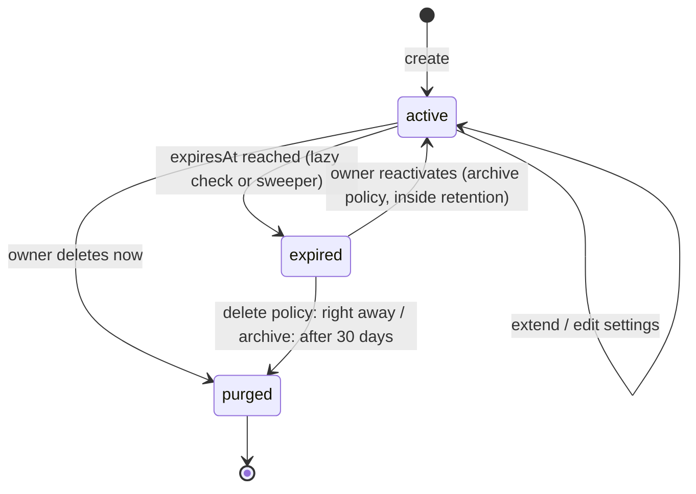
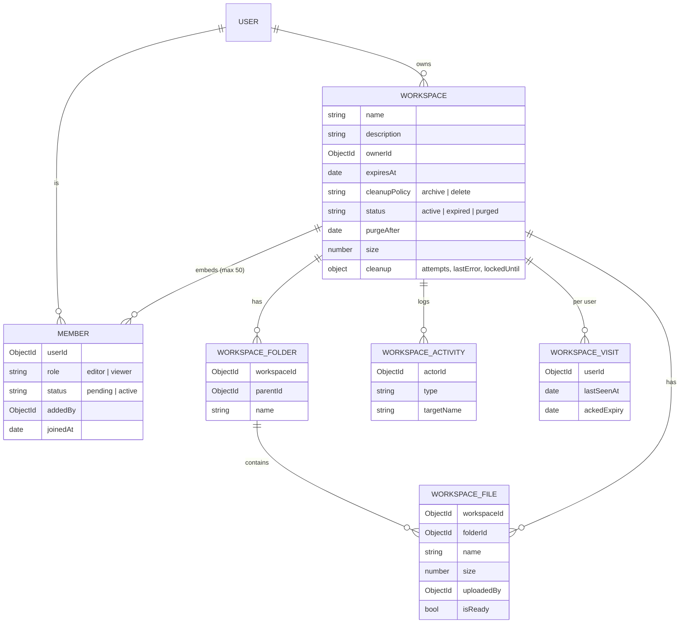

# Ephemeral Workspace

A temporary shared space: the owner invites people, everyone works on files
together, and when the expiry time passes access is revoked automatically and
the data is archived or deleted according to the workspace's cleanup policy.

## Lifecycle

- **Expiring soon** is not stored; it is derived (< 24 h left).
- **Expired**: members lose access immediately. With the `archive` policy the
  owner keeps read-only access until `purgeAfter`.
- **Purged**: B2 objects and all workspace rows are removed.

## Data model

Collections: `workspaces`, `workspacefiles`, `workspacefolders`,
`workspaceactivities`, `workspacevisits`. Run `npm run setup` (Server) after
pulling so their validators and indexes are created. Files are stored in B2 at
`workspaces/<workspaceId>/<fileId><ext>`, separate from personal files, so
Trash, storage usage and sharing are unaffected.

## Roles

| Action | Owner | Editor | Viewer | Invited (pending) |
| --- | :-: | :-: | :-: | :-: |
| View / download / save a copy to My Drive | ✔ | ✔ | ✔ | ✘ |
| Upload, import from My Drive, new folder, rename | ✔ | ✔ | ✘ | ✘ |
| Move / delete files | any | own | ✘ | ✘ |
| Delete folder | any | own & empty | ✘ | ✘ |
| Invite, change roles, remove, transfer, settings, delete workspace | ✔ | ✘ | ✘ | ✘ |

Every route re-checks this on the server (`utils/workspaceAccess.js`). A
non-member gets a uniform `404`; a member of an expired workspace gets `410`
with `code: "WORKSPACE_EXPIRED"`.

## API (all under `/workspace`, session cookie required)

| Method & path | Purpose |
| --- | --- |
| `GET /` , `POST /` | list my workspaces / create (members become pending invites) |
| `GET /:id`, `PATCH /:id`, `DELETE /:id` | details / edit (owner) / delete now (owner) |
| `POST /:id/reactivate` | reopen an archived workspace (owner) |
| `POST /:id/members`, `PATCH`/`DELETE /:id/members/:userId` | invite / change role / remove, cancel invite or leave |
| `POST /:id/invitation/accept` · `/decline` | invitee responds |
| `POST /:id/transfer` | transfer ownership to an active member |
| `GET /:id/files?folderId=` | folders + files + breadcrumb (also marks as seen) |
| `POST /:id/files` | streamed upload (headers `filename`, `filesize`, optional `folderId`) |
| `POST /:id/files/import` | copy a My Drive file in |
| `GET /:id/files/:fileId` | signed URL (`?format=json`, `?action=download`, `?format=text`) |
| `PATCH /:id/files/:fileId` · `/move` | rename / move |
| `POST /:id/files/:fileId/save-to-drive` | copy into My Drive |
| `DELETE /:id/files/:fileId` | delete |
| `GET/POST /:id/folders`, `PATCH/DELETE /:id/folders/:folderId` | folders |
| `GET /:id/activity?before=` | audit trail |
| `GET /search?q=` | file-name search across my open workspaces |
| `GET /notifications` | invitations, new files, expiry warnings |
| `GET /admin/all`, `POST /admin/:id/retry-cleanup` | admin: lifecycle/cleanup health (metadata only) |

## Expiry and cleanup

1. **Lazy enforcement** – every request runs `expireIfDue`, an atomic
   `active → expired` transition, so access ends at the exact expiry instant even
   if no background job ran. With the `delete` policy the winning request also
   starts the purge immediately.
2. **Sweeper** (`services/workspaceCleanupService.js`, every
   `WORKSPACE_SWEEP_SECONDS`, and once at startup): expires due workspaces,
   purges expired ones whose `purgeAfter` has passed, deletes uploads stuck
   longer than 2 h (crash recovery, releases their quota) and hands workspaces
   whose owner account was deleted to an active member (or closes them).
3. **Purge** is idempotent and lock-leased (`cleanup.lockedUntil`), so two
   instances never purge the same workspace. B2 objects are deleted in batches
   of 1000 and database rows are removed only after B2 confirms. Failures are
   recorded (`cleanup.attempts`, `cleanup.lastError`), retried up to 5 times,
   and visible to admins, who can retry from the Admin tab.

On Render's free tier the process can sleep. Access is still cut off on time (it
is checked per request); physical deletion happens on the next wake-up, which
the `/health` pinger keeps short.

## Limits and environment variables

| Variable | Default | Meaning |
| --- | --- | --- |
| `WORKSPACE_MAX_BYTES` | 500 MB | storage per workspace |
| `WORKSPACE_USER_MAX_BYTES` | 2 GB | total across all workspaces a user owns |
| `WORKSPACE_MAX_DAYS` | 90 | longest allowed lifetime |
| `WORKSPACE_ARCHIVE_DAYS` | 30 | archive retention |
| `WORKSPACE_SWEEP_SECONDS` | 60 | sweeper interval |

Also: 50 members, 25 active workspaces per owner, 200 folders per workspace,
6 folder levels. Expiry must be 5 minutes – 90 days ahead (checked on the
server). Rate limits: 20 workspaces/h, 60 invitations/h, 120 uploads/h.

## Notifications (in the bell)

- **Invitation** – Accept / Decline; no access until accepted.
- **New files** – one entry per workspace for files others uploaded since you
  last opened it.
- **Expiring soon** – within 24 h; dismissed once you open the workspace, and
  returns if the owner changes the expiry.

## Tests

`npm test` (in `Server`) runs unit tests for the permission table, state
derivation and request validation using Node's built-in runner.
